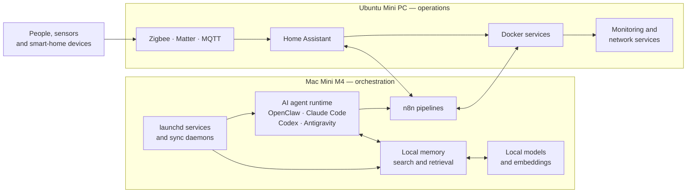

# Sepehr builds systems that keep running.

I’m a **medical doctor (MD)** and software/systems engineer working at the intersection of
clinical precision, self-hosted infrastructure, AI agents, and automation.

My engineering philosophy comes directly from medicine: **evidence before assertions,
fail-safe defaults, and zero tolerance for silent failures.**

My homelab is a two-machine production environment: a **Mac Mini M4** handles
orchestration, multi-agent runtimes, local AI, and native services; an **Ubuntu Mini PC**
runs Home Assistant, Docker workloads, and the network-facing automation layer.

The interesting part is not how many services it runs. It is how they coordinate,
recover, and remain understandable when nobody is watching.

## System topology

The split is intentional: macOS owns orchestration and workloads that benefit from
Apple silicon or native processes; Ubuntu owns home automation, containers, and
services that should remain independent of the development machine.

## Selected systems

| Project | What it does |
|---|---|
| **homelab** | Infrastructure definitions, deployment configuration, and operational runbooks for the two-machine homelab. |
| **homelab-command-center** | Single operational view of services, health, jobs, and infrastructure state with an MCP interface for agent diagnostics. |
| **open-ig-poster** | Security-conscious, self-hosted Instagram publishing queue with approval workflows, dry-run defaults, and retry guards. |
| **local-memory-search** | Private multilingual search across local clinical notes and project files with cited retrieval and local-model synthesis. |
| **homeassistant-config** | Source-controlled Home Assistant configuration for Zigbee, Matter, MQTT, presence, and cross-machine automations. |
| **mac-mini-scripts** | Operational scripts and unattended launchd jobs for backups, synchronization, health checks, and service recovery. |
| **ai-tooling** | Shared tooling and integrations for Claude Code, OpenAI Codex, Antigravity, OpenClaw, and local MCP servers. |

## What I care about

- **Clinical rigor in code:** Observable failure modes, idempotent execution, and automated verification before completion.
- **Local-first & privacy-first:** Sensitive data, notes, and routine AI inference stay strictly on hardware I control.
- **Operational truth:** A correct configuration file is not proof that the running system loaded it.
- **Useful agents:** Tools should retrieve evidence, cite their sources, and operate within strict sandbox boundaries.
- **Boring reliability:** Small services, clear interfaces, tested recovery paths, and zero hidden dependencies.

## Working stack

**Background:** Medical Doctor (MD), Systems & Automation Builder  
**ORCID iD:** [0000-0003-4524-0959](https://orcid.org/0000-0003-4524-0959)  
**Languages:** Python, TypeScript, JavaScript, Shell, YAML  
**Infrastructure:** macOS, Ubuntu, Docker Compose, launchd, Cloudflare, Tailscale  
**Automation:** Home Assistant, n8n, Zigbee, Matter, MQTT  
**AI Systems:** OpenClaw, Claude Code, OpenAI Codex, Antigravity, MCP, Ollama, vector retrieval
